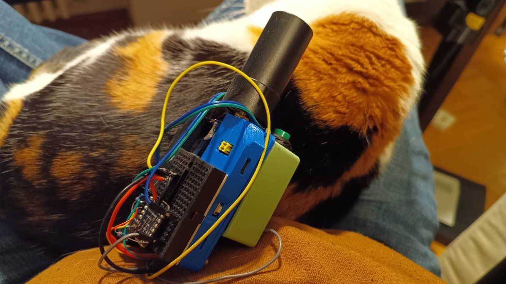
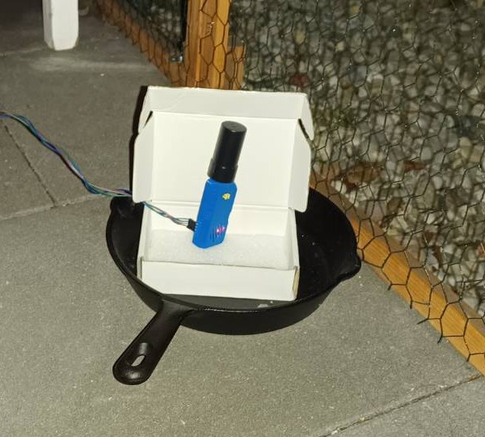
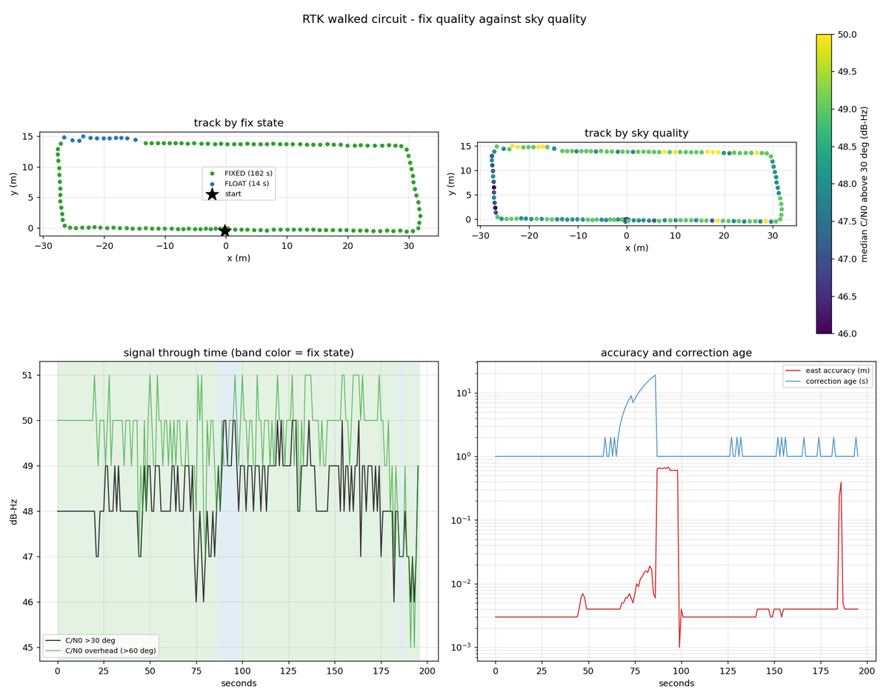

# Affordable handheld RTK

*The current hand-wired prototype, cat for scale. The prototype uses a Waveshare
LC29H board, in [this case from Printables](https://www.printables.com/model/1593114-case-for-lc29h-rtk-high-precision-positioning-gnss) (the blue one).*

> **Work in progress.** The device works in the field, but it is still a
> hand-wired prototype: the carrier PCB and the printed case are being designed
> (see [In progress](#in-progress)), and a few features, such as raw logging for
> PPK, are not yet confirmed on hardware.

A low-cost, open-source and open-hardware RTK GNSS receiver you can carry in
one hand. A Quectel LC29H dual-band module and a Seeed XIAO ESP32-C6 stream
centimeter-level positions to a phone over Bluetooth Low Energy, for
applications that need better than phone GPS but not survey-grade equipment:
mapping, and marking and finding points in a field.

The phone does the networking. Its GNSS app fetches RTCM3 corrections from an
NTRIP caster and writes them back over BLE, so the device itself needs no
internet connection. For apps that have no NTRIP client of their own, the
device can run one itself over the phone's hotspot.

    receiver TX --> UART --> NMEA --> Nordic UART ---> phone
                         \-> parse: LEDs, points, diagnostics
    receiver RX <-- UART <----------- corrections <--- phone

About EUR 75 in parts per unit (see [BOM.md](BOM.md)). It draws 62 mA on BLE
(measured), which works out to roughly 35-45 hours on an 18650.

## Why

My background is in mobile robotics - localization and mapping - and at work
RTK means survey-grade receivers like the u-blox ZED-F9P. I wanted something
for the field that could do reasonably good RTK in one hand without breaking
the bank: no tripod, no survey controller, no several-hundred-euro receiver,
for work where a few centimeters are plenty and a few meters are not.

Dual-band modules like the LC29H have made that possible for the price of a
dinner out. What they don't come with is a device around them: power, a
link to the phone, a way to tell at a glance whether it is fixed, and a way to
see what is going wrong in a field with no laptop. This project is that
device - built in the open, so that anyone who needs the same thing can build
one too.

## Field results

*Early testing on the balcony. On the receiver's older Quectel firmware it never reached an RTK fix; updating to Quectel's newest release fixed that. The cast-iron pan is a ground plane, to give it the best possible conditions, and the box holds the device upright.*

Walking a circuit around a building with the antenna on a pole, with network
RTK (VRS) corrections through the phone: **92 % of epochs RTK fixed**, at 4 mm
reported accuracy. The only loss of fix was a 19 s gap in the corrections
themselves - a mobile dead spot behind the building. The receiver held its fix
on the aging corrections for most of that gap and was fixed again 12 s after
they resumed.

*The pole-mounted circuit, plotted with `tools/plotwalk.py --anonymize`: fixed
(green) all the way round except the float stretch after the correction gap,
whose age climbs to 19 s in the bottom-right panel.*

In later tests in open fields, the device held in one hand kept its fix while
walking between points.

What does keep it from fixing is the sky, not the hardware: low down beside a
building it can sit in float for an hour. Judge a site, or an antenna, by the
debug panel's C/N0 for satellites above 30 degrees rather than by the
satellite count.

## Using it

The rover serves its NMEA stream over the **Nordic UART Service**. Any app
that reads one works; tested with **GNSS Master** on Android:

1. Pair the rover in the phone's Bluetooth settings ("Just Works", no PIN) -
   GNSS Master picks devices from the paired list.
2. In GNSS Master, select it as a BLE receiver and set up the NTRIP caster.
3. Enable GNSS Master's mock location. Every app on the phone then gets the
   RTK position in place of the phone's own GNSS.

Also suited: SW Maps, Lefebure NTRIP Client. The rover also publishes the
standard **Battery Service** (0x180F), so the phone shows its charge level.

## Features

- **RTK over BLE**, corrections byte-transparent from the phone to the receiver.
- **Accuracy for every app**: a `$GNGST` synthesized from the receiver's
  error estimate when its firmware has no GST of its own.
- **Point recording** with averaging, raw RTCM3 logs for PPK, and export to
  CSV, GeoJSON, KML and GPX.
- **Three status LEDs** that say whether it is fixed, floating or lost, without
  looking at the phone.
- **WiFi setup portal** with a live debug panel - sky view, C/N0 by elevation,
  correction content, rolling fix statistics - because attaching USB during a
  survey resets the board and the receiver's convergence with it.
- **Diagnostics in the NMEA stream** (`$PRTKA`, `$PRTKM`), for the same reason.
- **USB-to-GNSS bridge**, so a sealed unit's receiver firmware stays updatable.

## Build and flash

    pio run -e xiao_esp32c6 -t upload
    pio device monitor

The console prints the receiver init transcript, then

    [BLE] advertising as "RTK-Rover-A1B2" (xx:xx:xx:xx:xx:xx)

Host-native tests, no hardware needed:

    bazel test //...

Hardware: [docs/HARDWARE.md](docs/HARDWARE.md) for wiring and power,
[BOM.md](BOM.md) for parts and sourcing. The current units are hand-wired.

## Recording points

Press the mark button (D8) to record a point. It settles for 10 s (hold the
pole still), then records for 60 s: every epoch is averaged, and the receiver's
raw observations are logged alongside. Press again while settling to cancel,
or while recording to finish early. The averaged point goes into
`/points.csv` on the board's flash, whatever the solution - the record says
which it was, how many epochs it came from and how far they scattered.

The lamps, while it runs: green and yellow alternating = settling; a quick
blip twice a second = recording (green fixed, yellow not fixed, red no
position). When it ends: three green flashes = saved, RTK fixed; three yellow =
saved without a fix; one long red = nothing saved.

The portal offers the same start/finish/cancel, lists the points, and serves
them as **CSV**, **GeoJSON**, **KML** and **GPX**. Points are named P0001,
P0002, ... and survive power cycles.

### Raw logs and PPK

Each point also gets `/raw/<point>_<UTC>.rtcm3`: RTCM3 MSM4 observations and
broadcast ephemerides, the receiver's own data from the occupation (Quectel
documents raw output for the (BS) variant; on the (DA) it is still to be
confirmed on hardware). It is there for post-processing when the live corrections were missing or poor -
the same thing a DJI RTK drone's `.obs`/`.nav` are for. Convert on a PC with
RTKLIB:

    tools/rtcm2rinex.sh P0001_20261006T090507.rtcm3

which writes RINEX 3 `.obs` and `.nav`, ready for RTKLIB, Emlid Studio or
any PPK tool together with a base station's data (SAPOS offers it for
post-processing). A raw log takes roughly 1-2 kB/s, so the flash holds about
ten occupations: download and delete them regularly.

Coordinates are in the frame of the correction service: ETRS89 with SAPOS,
whatever the base was surveyed in with a community caster. Each record holds
both heights. The ellipsoidal one is what the receiver solved for; the
sea-level one depends on the receiver's built-in geoid model, which is coarse,
so it is not a height in the official national height system (DHHN2016).
GeoJSON carries the ellipsoidal height, as RFC 7946 requires; KML and GPX the
sea-level one, as theirs expect.

## Layout

Firmware that needs the ESP32 lives in `src/`. Everything that does not - the
parsers, the statistics, the formats - is a library in `lib/`, built by
PlatformIO for the device and by Bazel for the host tests.

    src/main.cpp            UART <-> BLE, both directions
    src/ble_server.*        Nordic UART, Battery Service, corrections sink
    src/gnss_lc29h.*        receiver configuration at boot
    src/battery.*           cell voltage -> state of charge
    src/provisioning.*      WiFi setup portal and debug panel, radio off otherwise
    src/ntrip.*             device-side NTRIP client
    src/hotspots.*          known WiFi networks for it
    src/bridge.*            USB <-> receiver passthrough for firmware updates
    src/points.*            point recording: button, occupation, flash files

    lib/config/             pins, UUIDs, buffer sizes, behavior switches
    lib/nmea/               NMEA 0183 reader, and GST synthesis
    lib/skyview/            GSV: satellites, C/N0 and bands the antenna can see
    lib/rtcm/               downlink frame check and correction content
    lib/diag/               diagnostics as NMEA, since USB resets the board
    lib/fieldstats/         rolling window: how the solution behaved, not just now
    lib/status_led/         what the three lamps say
    lib/scatter/            spread of the float solution
    lib/points_format/      point averaging and the CSV/GeoJSON/KML/GPX exports
    lib/uplink_split/       receiver output -> NMEA text + RTCM3 frames
    lib/textbuf/            bounded text building

    test/                   host-native tests (Bazel)
    tools/                  debug panel recorder, walk plotter, RINEX conversion
    docs/PROTOCOL.md        what goes over BLE
    docs/HARDWARE.md        wiring and power
    BOM.md                  parts and cost per unit

## Design notes

**Accuracy on the LC29H.** The protocol specification states that "GST is not
supported on LC29H (BA, CA, DA, EA)", so the usual per-axis accuracy sentence
does not exist on this receiver. It reports `$PQTMEPE` instead
(north/east/down error), which the parser maps onto latitude/longitude/height
accuracy. For raw-NMEA apps that read accuracy from GST, a `$GNGST` is
synthesized from those figures and injected at a sentence boundary - otherwise
those numbers would be invisible to them. Set `SYNTH_GST` to 0 in `lib/config/config.h`
for a strictly byte-transparent stream.

**The corrections path is transparent.** The LC29H(DA) is an RTK rover by
design: RTCM3 written to its UART is consumed with no enabling command, so
nothing needs to interpret the correction stream.

## In progress

### Carrier PCB (KiCad)

A small board the XIAO ESP32-C6 sits on, replacing the hand wiring. The GNSS
board stays a separate module on a four-wire lead (RX, TX, GND, power): LC29H
boards come in several slightly different versions, and the design should not
depend on one. The charger is a TP4056 module with protection, also soldered
on as a module. The board itself carries only the LEDs (1206), their
resistors, the cell divider and decoupling (0805, hand-solderable), headers
for the power switch, mark button and mode switch, and optional footprints for
a P-FET that switches the receiver's supply (for the USB bridge) and a
polyfuse in the cell line. Bare boards, assembled by hand.

### Printed case

A PETG or ASA shell that clips to a vest breast pocket or mounts on a pole,
with the helix antenna on top and vertical for a clear view of the sky. The
cell sits in a cradle inside, beside the charger. The power switch and mode
switch are recessed so a strap cannot move them; the mark button and the three
LEDs are on the face. USB-C gets an overhang against rain. STL files and the
parametric source go here once the PCB fixes the internal layout.
Until then, the prototype's Waveshare LC29H board sits in a
[community case from Printables](https://www.printables.com/model/1593114-case-for-lc29h-rtk-high-precision-positioning-gnss).

## How it was built

I started this project from my own code and designed, built and field-tested
the hardware. For expediency, parts of the implementation and documentation
were developed with an AI coding assistant (Claude); the design decisions, the
testing on real hardware and the review of every change and line of code
are mine.

## License

Firmware and tools: [MIT](LICENSE). Hardware design files: CERN-OHL-S-2.0, as
they are added.

Not affiliated with Quectel, Seeed Studio, or any app named here; names are
used only to say what the device works with.
